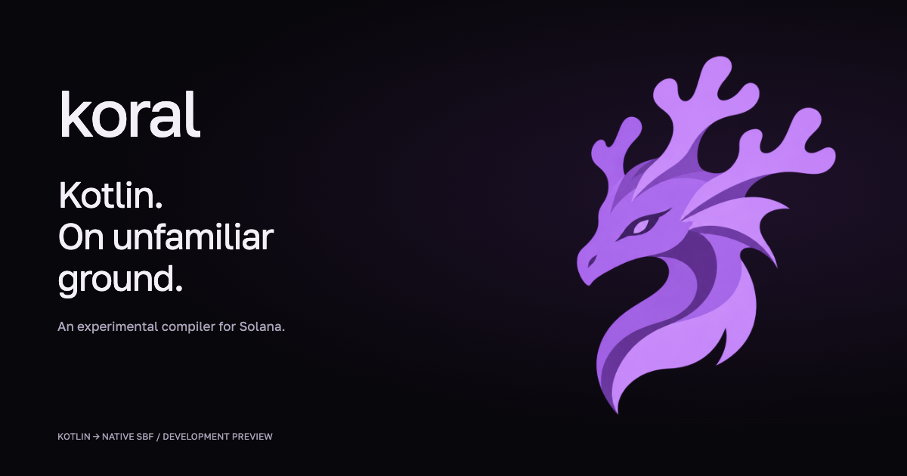

<a href="https://koral.tools"></a>

### Familiar Kotlin. Native Solana.

We build Kotlin tooling for on-chain development, starting with Solana.

**Koral** is an experimental compiler that takes a restricted Kotlin subset to native Solana SBF. No JVM inside the program. Inspect the source, build artifacts, and local execution evidence.

**[Get started](https://koral.tools/start.html)** · **[Download the preview](https://github.com/koral-toolchain/koral-solana/releases/tag/v0.1.0-dev)** · **[Try the playground](https://koral.tools/playground.html)** · **[Read the docs](https://koral.tools/docs/)**

### A small beginning

```kotlin
import dev.koral.api.Instruction
import dev.koral.api.checkedAdd

@Instruction
fun increment(count: ULong, by: ULong): ULong =
    checkedAdd(count, by)
```

A real Counter instruction from the current compiler examples. The Counter runtime validates authority and persists the returned count.

`Kotlin → Koral checks → C → Clang/LLVM → Solana SBF`

### Explore Koral

| Repository | Inside |
| --- | --- |
| [koral-solana](https://github.com/koral-toolchain/koral-solana) | Compiler, CLI, examples, and local execution checks. |
| [handbook](https://github.com/koral-toolchain/handbook) | Development standards, compatibility policy, and release checks. |

[Release policy](https://github.com/koral-toolchain/handbook/blob/main/guides/releases.md) · [Compiler release checklist](https://github.com/koral-toolchain/koral-solana/blob/main/docs/RELEASING.md)

**Current preview:** Counter, restricted unsigned-integer account state, and authority-funded SOL transfers through System Program CPI. General Kotlin support, SPL Token CPI, PDA signing, and complete DEX programs are outside this release.

Source is available to inspect under the repository's [license terms](https://github.com/koral-toolchain/koral-solana/blob/main/LICENSE). Original code rights are reserved; external contributions are currently closed.

---

[Website](https://koral.tools) · [Benchmarks](https://koral.tools/benchmarks.html) · [Roadmap](https://koral.tools/roadmap.html)
